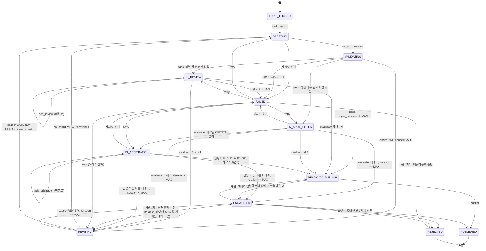

# 03. 상태 기계

## 1. `PostDraft` 상태도

`iteration` 은 0에서 시작한다. v1을 쓸 때는 0이다. `REVISING`에서 `DRAFTING`으로 나갈 때 `revision_cause == REVIEW` 인 경우에만 1 증가한다. 게이트 재시도와 사람의 재수정 허가는 증가시키지 않는다. `MAX_ITERATIONS` 가 2이면 리뷰 반영 수정은 v2, v3 두 번이고, 그 다음 미해소는 `ESCALATED` 다.



글 예산 초과와 코루틴 안의 예상하지 못한 예외는 `mark_failed`로 `FAILED`다. 라운드 중단(`abort_round`)이면 `reject_by_abort(reason)`로 `REJECTED`에 간다. 종결 상태(`PUBLISHED`, `REJECTED`)는 모두 예외다. 도식에는 중단 전이를 `ESCALATED`·`FAILED`에서만 그렸고, 내부 오류(29행)로 `FAILED`에 들고 나는 화살표는 그리지 않았다. 내부 오류는 종결·`ESCALATED`·`FAILED` 외 어느 상태에서든 `FAILED`로 보내고, 재개하면 그 상태로 돌아간다. `FAILED`에서는 `retry_from_failed`로 재개하거나 `discard`로 그 글만 폐기한다. 중단은 진행 중인 호출을 끊지 않는다. 호출이 끝난 뒤 저장 충돌로 결과를 버린다(04 문서 1절).

## 2. 전이표

행은 위에서부터 첫 일치만 적용한다. 13a~13c행과 14행은 `cause`가 먼저 갈라지므로, 게이트 재시도와 사람 재수정은 `iteration == MAX`여도 14행으로 떨어지지 않는다.

실패 횟수. `validation_retries`, 호출 시도 수, `publish_attempts`는 0에서 시작한다. 실패 이벤트는 그 카운터를 한 번만 1 증가시킨 뒤 가드를 본다. 증가한 값이 상한과 같으면 중단하고, 미만이면 다시 시도한다. 성공은 카운터를 올리지 않는다. 상한은 모두 실패했을 때의 호출 수다. `validation_retries`는 게이트를 통과하면, `publish_attempts`는 사람이 `PUBLISH_AS_IS`·`REVISE`를 고르면 0이 된다. 호출 시도 수는 호출 서비스 안의 지역 값이라 재개하면 새로 센다. 주제 제안 시도(`TopicAttempt.attempt_number`)만 1부터 매기고, 그 번호가 상한과 같은 시도가 실패하면 라운드를 `ABORTED`로 둔다.

| # | 현재 | 이벤트 | 가드 | 다음 | 부수 효과 |
|---|---|---|---|---|---|
| 1 | (문서 없음) | 세 슬롯 주제 확정 | – | `TOPIC_LOCKED` | 글 3편 생성(`token_limit = DRAFT_TOKEN_LIMIT`). 레지스트리 `RESERVED`. 쓰기 순서는 04 문서 1절 |
| 2 | `TOPIC_LOCKED` | 글 코루틴 | – | `DRAFTING` | 이어서 `WRITE_DRAFT` 호출. iteration 은 0 |
| 3 | `DRAFTING` | 작성자 응답 파싱 성공 | 스키마 유효 | `VALIDATING` | 버전 추가, `passed_validation=False`. 새 버전의 `origin_cause`는 `revision_cause`로 정하고, `revision_cause`와 승인을 지운다 |
| 4 | `DRAFTING`, `IN_REVIEW`, `IN_SPOT_CHECK`, `IN_ARBITRATION` | 응답 실패 | 증가 후 시도 수 `< MAX_LLM_RETRIES` | 변화 없음 | 호출 서비스 안에서 백오프 뒤 다시 호출한다. 글은 저장하지 않는다 |
| 5 | `DRAFTING`, `IN_REVIEW`, `IN_SPOT_CHECK`, `IN_ARBITRATION` | 응답 실패 | 증가 후 시도 수 `== MAX_LLM_RETRIES` | `FAILED` | `FailureRecord(LLM_RETRIES_EXHAUSTED)`. 병렬 단계는 다른 호출이 끝나기를 기다려 성공한 결과를 저장한 뒤 `FAILED`. 사유가 여럿이면 `BUDGET_EXCEEDED`를 남긴다 |
| 5a | `DRAFTING`, `IN_REVIEW`, `IN_SPOT_CHECK`, `IN_ARBITRATION` | 호출 전 예산 검사 | 글 사용량 + 추정치 `> token_limit` | `FAILED` | `FailureRecord(BUDGET_EXCEEDED)`. 호출하지 않는다. 병렬 단계는 5행처럼 성공분을 저장 |
| 6a | `VALIDATING` | 게이트 통과 | `origin_cause == HUMAN` | `READY_TO_PUBLISH` | `passed_validation=True`, `validation_retries=0`. 사람이 개입해 고친 버전은 에이전트 재리뷰 없이 발행 대기 |
| 6b | `VALIDATING` | 게이트 통과 | `origin_cause != HUMAN`, 리뷰 완료 이전 버전 없음 | `IN_REVIEW` | `passed_validation=True`, `validation_retries=0`. FULL 리뷰 호출 ×2 |
| 7 | `VALIDATING` | 게이트 통과 | `origin_cause != HUMAN`, 리뷰 완료 이전 버전 있음 | `IN_SPOT_CHECK` | `passed_validation=True`, `validation_retries=0`. 그 버전의 `open_blocking_items` 에 본인 항목이 남은 리뷰어만 SPOT_CHECK |
| 8 | `VALIDATING` | 게이트 실패 | 증가 후 `validation_retries < MAX_VALIDATION_RETRIES` | `REVISING` | `cause=GATE`. `iteration`·`origin_cause` 유지. 상한 2이면 재작성은 1회 |
| 9 | `VALIDATING` | 게이트 실패 | 증가 후 `validation_retries == MAX_VALIDATION_RETRIES` | `FAILED` | 연속 두 번째 실패. `FailureRecord(GATE_RETRIES_EXHAUSTED)` |
| 10 | `IN_REVIEW` | 리뷰 도착 | 미완료 | `IN_REVIEW` | `derived_verdict` 저장 |
| 11 | `IN_REVIEW` | 리뷰 도착 | 완료, 차단 0건 | `READY_TO_PUBLISH` | MINOR·NITPICK 은 수정 대상이 아니다 |
| 12 | `IN_REVIEW` | 리뷰 도착 | 완료, 차단 ≥1 | `REVISING` | `cause=REVIEW` |
| 13a | `REVISING` | 글 코루틴 | `cause=GATE` | `DRAFTING` | `iteration` 과 직전 `origin_cause` 유지. `REVISE_DRAFT`. 직전 `origin_cause == HUMAN` 이면 `human_instruction` 도 넣는다 |
| 13b | `REVISING` | 글 코루틴 | `cause=HUMAN` | `DRAFTING` | `iteration` 유지, 새 버전의 `origin_cause=HUMAN`. `human_instruction` 입력 포함 |
| 13c | `REVISING` | 글 코루틴 | `cause=REVIEW`, `iteration < MAX` | `DRAFTING` | `iteration += 1`, 새 버전의 `origin_cause=REVIEW`. `REVISE_DRAFT` |
| 14 | `REVISING` | 글 코루틴 | `cause=REVIEW`, `iteration == MAX` | `ESCALATED` | `MAX_ITERATIONS_REACHED`. 13a·13b 다음에 평가한다. 17·21행이 이미 `iteration < MAX`를 보므로 `MAX_ITERATIONS ≥ 1`이면 도달하지 않는 방어 행이다 |
| 15 | `IN_SPOT_CHECK` | 리뷰 도착 | 완료, 미해소 0건 | `READY_TO_PUBLISH` | – |
| 16 | `IN_SPOT_CHECK` | 리뷰 도착 | 완료, 미중재 교착 CRITICAL 존재 | `IN_ARBITRATION` | 교착 항목마다 `ARBITRATE`. iteration 과 무관하게 16이 17·18보다 앞 |
| 17 | `IN_SPOT_CHECK` | 리뷰 도착 | 완료, 미해소 ≥1, `iteration < MAX` | `REVISING` | `cause=REVIEW`. 신규 CRITICAL, 수용 후 미해소가 여기 온다 |
| 18 | `IN_SPOT_CHECK` | 리뷰 도착 | 완료, 미해소 ≥1, `iteration == MAX` | `ESCALATED` | – |
| 19 | `IN_ARBITRATION` | 항목 하나 도착 | `not arbitration_complete()` | `IN_ARBITRATION` | 저장만 |
| 20 | `IN_ARBITRATION` | 전체 도착 | 전원 `UPHOLD_AUTHOR` 이고 그 외 미해소 0 | `READY_TO_PUBLISH` | 인용된 항목 종결 |
| 21 | `IN_ARBITRATION` | 전체 도착 | `UPHOLD_REVIEWER` 또는 그 외 미해소, `iteration < MAX` | `REVISING` | `cause=REVIEW`. 인용 항목은 다음 버전에서 기각 불가 |
| 22 | `IN_ARBITRATION` | 전체 도착 | 21과 같고 `iteration == MAX` | `ESCALATED` | – |
| 23 | `ESCALATED` | `PUBLISH_AS_IS` | `passed_validation` 버전이 있음. 없으면 409 | `READY_TO_PUBLISH` | `approved_by` 기록. 발행본은 마지막 `passed_validation` 버전. `publish_attempts=0`, `publication_intent` 삭제. `PUBLISH_UNCERTAIN` 이면 블로그에 글이 없음을 사람이 확인한 뒤에만 고른다 |
| 23a | `ESCALATED` | `CONFIRM_PUBLISHED(external_post_id)` | `escalation_reason == PUBLISH_UNCERTAIN` | `PUBLISHED` | 사람이 블로그에서 찾은 게시글 id로 `Publication` 저장, 레지스트리 `PUBLISHED`. Post BE 를 다시 호출하지 않는다 |
| 24 | `ESCALATED` | `REVISE(instruction)` | – | `REVISING` | `cause=HUMAN`, `human_instruction` 저장. `publish_attempts=0`, `publication_intent` 삭제. `PUBLISH_UNCERTAIN` 이면 블로그에 글이 없음을 사람이 확인한 뒤에만 고른다. 통과 시 6a 행으로 바로 `READY_TO_PUBLISH` |
| 25 | `ESCALATED` | `REJECT` | – | `REJECTED` | 레지스트리 `RELEASED`. `PUBLISH_UNCERTAIN` 이면 블로그를 먼저 확인한다(올라가 있으면 `CONFIRM_PUBLISHED`) |
| 26 | `FAILED` | 재시도 | `failure` 존재 | `failure.from_status`. `GATE_RETRIES_EXHAUSTED` 면 `REVISING`(`cause=GATE`) | 모델은 상태만 되돌린다. 저장된 리뷰·중재는 다시 호출하지 않는다. 게이트 실패면 `validation_retries=0`. 어느 사유든 새 `token_limit` 을 받을 수 있다. 다음 스캔이 글 코루틴을 띄운다 |
| 26a | `FAILED` | 폐기(사람) | – | `REJECTED` | `discard`. 레지스트리 `RELEASED` |
| 27 | `READY_TO_PUBLISH` | 발행 성공 | 승인 토글 off 또는 승인 존재, 반영 시점에도 `READY_TO_PUBLISH` | `PUBLISHED` | 레지스트리 `PUBLISHED`, 요약 노트. 이미 `REJECTED`면 전이하지 않는다 (04 문서) |
| 28a | `READY_TO_PUBLISH` | 발행 실패(결과 확정) | 증가 후 `publish_attempts < MAX_PUBLISH_ATTEMPTS` | `READY_TO_PUBLISH` | 지수 백오프 뒤 다시 호출. `PublicationIntent.attempt`는 호출 직전의 `publish_attempts + 1` |
| 28 | `READY_TO_PUBLISH` | 발행 실패(결과 확정) | 증가 후 `publish_attempts == MAX_PUBLISH_ATTEMPTS` | `ESCALATED` | `PUBLISH_FAILED` |
| 28b | `READY_TO_PUBLISH` | 발행 결과 불명 | – | `ESCALATED` | `PUBLISH_UNCERTAIN`. 다시 호출하지 않는다 |
| 29 | 종결·`ESCALATED`·`FAILED` 외 전부 | 코루틴 안의 예상하지 못한 예외 | – | `FAILED` | `FailureRecord(INTERNAL_ERROR)`. 스캔이 같은 오류로 호출을 되풀이하지 않게 멈춘다 |
| 30 | 종결 외 전부 (`ESCALATED`·`FAILED` 포함) | 라운드 중단 `abort_round` | – | `REJECTED` | `reject_by_abort(reason)`. 진행 중인 호출은 끊지 않고 결과를 버린다. 레지스트리 `RELEASED`. `is_active` 와 무관하게 `abort_round` 가 직접 호출. 쓰기 순서는 04 문서 1절 |

"차단 등급" = `CRITICAL` 또는 `MAJOR`. "미해소"·"교착" 정의는 04 문서. 승인 대기 중인 `READY_TO_PUBLISH` 는 코루틴을 띄우지 않는다. 발행 실패의 "결과 확정"과 "결과 불명" 구분은 04 문서 8절.

## 3. `PublishingRound` 상태 전이

```
라운드 생성 ──► TOPIC_SELECTION ──3개 주제 확정──► IN_PROGRESS ──3편 모두 종결──► COMPLETED
                     │                                  │
                     │ 시도 상한·제안 호출 실패·        │ 관리자 중단
                     │ 내부 오류·관리자 중단            │
                     └──────────────────────────────────┴──► ABORTED
```

라운드 문서는 `TOPIC_SELECTION`으로 생긴다. 검사를 생성 전에 끝내므로 "만들었지만 시작하지 않은" 상태가 없다.

| 현재 | 이벤트 | 가드 | 다음 |
|---|---|---|---|
| (문서 없음) | 라운드 생성 | 슬롯 바인딩 3개 유효, 렌즈 매트릭스 유효, 카테고리 스냅샷 읽기 성공, 다른 `TOPIC_SELECTION` 라운드 없음 | `TOPIC_SELECTION`. 다른 라운드가 있으면 insert 가 부분 unique 인덱스(02 문서 6절)에 걸려 409이고 문서가 남지 않는다 |
| `TOPIC_SELECTION` | 제안 3세트 수집 → 배정 성공 | 중복 없음 | `IN_PROGRESS` (3개 `PostDraft` → `TOPIC_LOCKED`) |
| `TOPIC_SELECTION` | 배정 실패 | `attempt_number < MAX_TOPIC_ATTEMPTS` | `TOPIC_SELECTION` (충돌 슬롯만 재제안) |
| `TOPIC_SELECTION` | 배정 실패 | `attempt_number == MAX_TOPIC_ATTEMPTS` | `ABORTED` (`TOPIC_ATTEMPTS_EXHAUSTED`). 라운드 안 주제 겹침을 허용하는 강제 배정은 하지 않는다 |
| `TOPIC_SELECTION` | `PROPOSE_TOPIC` 호출 재시도 소진 | – | `ABORTED` (`LLM_FAILED`). 다른 제안 호출이 끝난 뒤 쓴다 |
| `TOPIC_SELECTION` | 코루틴 안의 예상하지 못한 예외 | – | `ABORTED` (`INTERNAL_ERROR`) |
| `TOPIC_SELECTION` | 관리자 중단 | – | `ABORTED` (`MANUAL`). 진행 중인 제안 호출은 끊지 않고 결과를 버린다. 확정 쓰기 도중이었으면 만들어진 글·레지스트리를 정리한다 |
| `IN_PROGRESS` | 글 종결 | 라운드가 아직 `IN_PROGRESS` 이고 3편 모두 `PUBLISHED` 또는 `REJECTED` | `COMPLETED`. 조건 쓰기가 `ABORTED`와 겹치면 이 전이는 실패한다 |
| `IN_PROGRESS` | 관리자 중단 | – | `ABORTED` (`MANUAL`). 글 폐기·레지스트리 정리 (04 문서 1절 순서) |

- `IN_PROGRESS`에서 글 하나가 `ESCALATED`여도 라운드는 `IN_PROGRESS`를 유지하고 나머지 둘은 발행된다. **부분 발행 허용**이 기본 정책이다(07 문서 결정 D-04).
- 주제 선정 중인 라운드는 한 번에 하나다. 동시에 주제를 고르는 라운드가 없으므로, 앞 라운드가 확정 때 남긴 레지스트리만 보면 라운드 사이 중복을 막는다(07 문서 D-28).
- 주제 확정은 전체 잠금을 `TopicAttempt`에 저장하고, 글 3편과 레지스트리 3건을 결정론적 ID로 없을 때만 만든 뒤 라운드를 `IN_PROGRESS`로 바꾼다. 라운드 전환이 커밋 지점이다. 그 전에 죽으면 라운드가 아직 `TOPIC_SELECTION`이라 코루틴이 저장된 잠금으로 같은 ID를 다시 쓴다(04 문서 1절).

## 4. 리뷰 렌즈 배정

슬롯 번호에 렌즈를 고정하지 않는다. 라운드의 `ModelBinding` 이 가리키는 세 `primary_lens` 로 계산한다. 세 렌즈가 서로 다르면 계산할 수 있고, 같으면 라운드 시작이 거절한다.

각 글에서 두 리뷰어의 주 렌즈는 작성자 렌즈를 뺀 둘이다. 작성자 렌즈는 어느 리뷰어의 주 렌즈도 아니므로, 한 리뷰어의 `secondary_lens` 로 붙인다. 붙이는 리뷰어는 다음 순서로 고른다.

1. 주 렌즈가 `CRITICAL_PRACTICAL` 이 아닌 리뷰어.
2. 그 조건을 둘 다 만족하면 주 렌즈가 `FACT_STRUCTURE` 인 리뷰어.

기본 바인딩(A=`LOGIC_READABILITY`, B=`FACT_STRUCTURE`, C=`CRITICAL_PRACTICAL`)이면 결과는 아래와 같다.

| 글 | 작성자 렌즈 | 보조 렌즈를 받는 리뷰어 | 다른 리뷰어 |
|---|---|---|---|
| A의 글 | `LOGIC_READABILITY` | B: 주 `FACT_STRUCTURE`, 보조 `LOGIC_READABILITY` | C: 주 `CRITICAL_PRACTICAL` |
| B의 글 | `FACT_STRUCTURE` | A: 주 `LOGIC_READABILITY`, 보조 `FACT_STRUCTURE` | C: 주 `CRITICAL_PRACTICAL` |
| C의 글 | `CRITICAL_PRACTICAL` | B: 주 `FACT_STRUCTURE`, 보조 `CRITICAL_PRACTICAL` | A: 주 `LOGIC_READABILITY` |

보조 렌즈는 프롬프트의 2순위 관점이다. 저장 형태는 `ReviewAssignment` (02 문서). 라운드를 만들기 전에 글 세 편 각각에 대해 세 렌즈가 모두 들어가는지 검사한다.

## 5. 상수

| 이름 | 기본값 | 설명 |
|---|---|---|
| `MAX_ITERATIONS` | 2 | 리뷰 반영 수정 횟수. v1 위에 v2·v3. 게이트 재시도와 사람 재수정은 세지 않는다 |
| `MAX_TOPIC_ATTEMPTS` | 2 | 초기 포함 총 제안 횟수. `attempt_number`는 1부터. 2번 시도가 실패하면 `ABORTED` |
| `MAX_LLM_RETRIES` | 3 | 한 단계 호출이 모두 실패할 때의 호출 수. 실패를 센 뒤 3이면 글 `FAILED`, 주제 선정이면 라운드 `ABORTED` |
| `MAX_VALIDATION_RETRIES` | 2 | 연속 게이트 제출이 모두 실패할 때의 횟수. 실패를 센 뒤 2이면 `FAILED`. 연속 재작성은 1회. 통과하면 다시 센다 |
| `MAX_PUBLISH_ATTEMPTS` | 3 | 발행 호출이 결과 확정 실패로 모두 실패할 때의 횟수. 실패를 센 뒤 3이면 `ESCALATED` |
| `DRAFT_TOKEN_LIMIT` | 설정 | 글 1편 토큰 소프트 상한. 글 호출 직전에 검사한다. 넘는 폭은 그 글의 동시 호출 몇 건. 라운드 상한은 없다 |
| `TOPIC_KEYWORD_OVERLAP` | 0.5 | 키워드 Jaccard. 각 3개일 때 2개 일치(2/4=0.5)부터 중복. 1개 일치(1/5=0.2)는 통과 |
| `TOPIC_TITLE_OVERLAP` | 0.5 | 제목 토큰 집합 Jaccard. 이 값 이상이면 중복 |
| `TOPIC_AVOID_LOOKBACK_DAYS` | 180 | 주제 제안 입력의 회피 목록에 넣을 레지스트리 발행 주제의 기간. 중복 판별은 기간과 무관하게 `RESERVED`·`PUBLISHED` 전부와 한다 |
| `DRAFT_MIN_CHARS` | 4000 | 본문 길이 하한. 앵커·코드 포함 |
| `DRAFT_MAX_CHARS` | 12000 | 본문 길이 상한 |
| `REVIEW_TIMEOUT_S` | 300 | 리뷰·중재 LLM 호출 제한. 초과하면 그 호출의 실패로 재시도 |
| `DRAFT_TIMEOUT_S` | 600 | 주제 제안·초안 작성·수정 LLM 호출 제한. 타임아웃이 있어야 모든 에이전트 단계가 끝난다 |
| `PUBLISH_TIMEOUT_S` | 30 | 로그인·발행 HTTP 호출 제한. 글 생성 호출의 응답 전 타임아웃은 결과 불명이고, 로그인 단계의 실패는 무엇이든 결과 확정이다 (04 문서 8절) |
| `SCAN_INTERVAL_S` | 15 | 러너가 코루틴 없는 진행 대상(사람 결정·CLI 변경·기동 뒤 남은 글)을 찾는 주기 |
